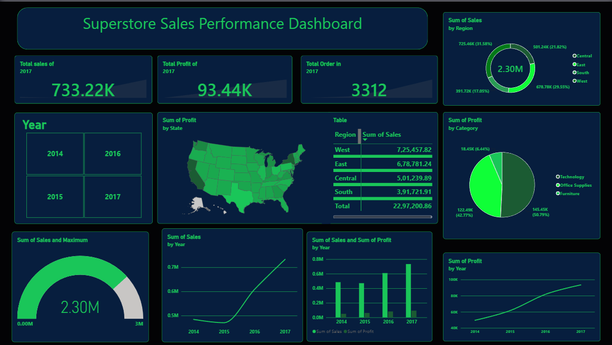

# 📊 Superstore Sales Performance Dashboard

## 📌 Project Overview
This project focuses on analyzing Superstore sales performance using Microsoft Power BI. The dashboard provides an interactive overview of sales, profit, orders, regional performance, and product category trends.

The goal is to transform raw sales data into meaningful visual insights that can help businesses understand their performance and make data-driven decisions.

## 🎯 Project Objectives
- Analyze overall sales and profit performance.
- Compare sales across different years.
- Understand regional sales distribution.
- Evaluate profitability across product categories.
- Identify trends and patterns in business performance.
- Present key business metrics through an interactive dashboard.

## 📷 Dashboard Preview



## 📈 Dashboard Features

**1. KPI Analysis**
- Total Sales
- Total Profit
- Total Orders

**2. Regional Analysis**
- Sales distribution across different US regions.
- State-level profit visualization.
- Regional sales comparison.

**3. Category Analysis**
- Profit contribution by product category.
- Category-wise performance comparison.

**4. Time-Based Analysis**
- Year-wise sales trends.
- Year-wise profit trends.
- Interactive year selection.

## 🛠️ Tools & Technologies
- Microsoft Power BI
- Power Query (include if used)
- DAX (include if used)
- Data Visualization
- Business Intelligence

## 💡 Business Questions Explored
- Which region contributes the most to overall sales?
- Which product category generates the highest profit?
- How do sales change over different years?
- How does profitability vary across regions?
- What patterns can be identified from yearly sales and profit trends?

## 📂 Repository Structure

```text
Superstore-Sales-Analysis/
│
├── Dashboard/
│   ├── Superstore_Dashboard.pbix
│   └── Dashboard_Screenshot.png
│
├── Dataset/
│   └── Superstore_Dataset.xlsx
│
├── Documentation/
│   ├── Business_Insights.md
│   └── DAX_Measures.md
│
└── README.md
```

## 🚀 How to Use This Project

1. Clone or download this repository.
2. Install Microsoft Power BI Desktop.
3. Open `Superstore_Dashboard.pbix`.
4. If required, update the dataset file path.
5. Refresh the data and explore the dashboard.

## 📚 Learning Outcomes

Through this project, I strengthened my understanding of:
- Business data analysis.
- Dashboard development.
- KPI visualization.
- Sales and profit analysis.
- Data storytelling.
- Interactive reporting in Power BI.

## 👨‍💻 Author

**Mohit Rawat**

Aspiring Data Analyst | BCA Student

[GitHub](https://github.com/mohitrawat9683)

---

⭐ If you find this project useful, feel free to explore the repository!
